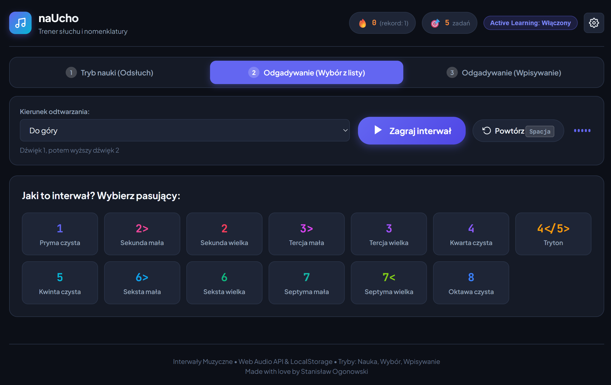
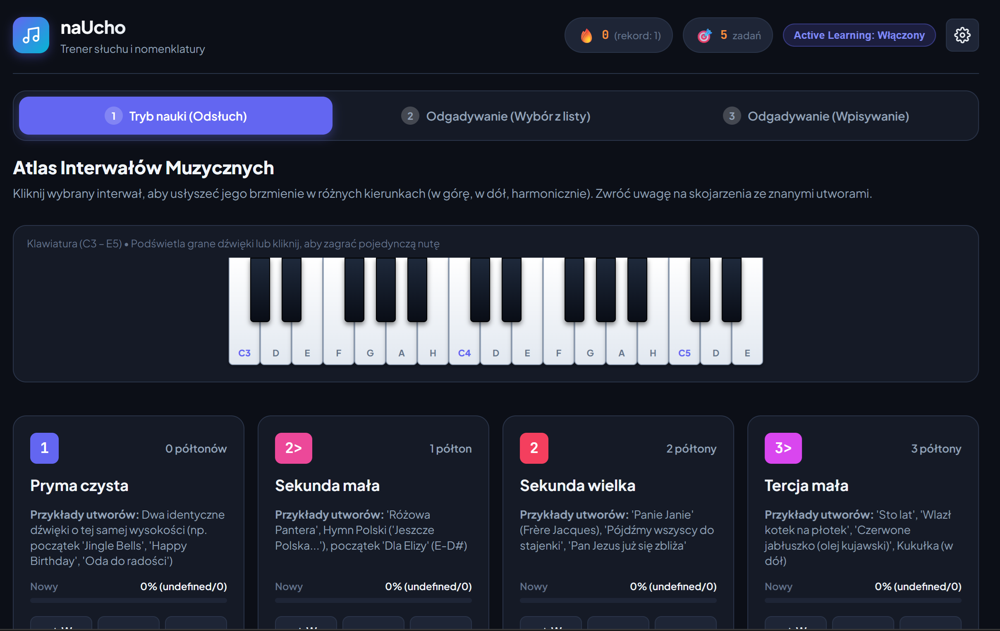
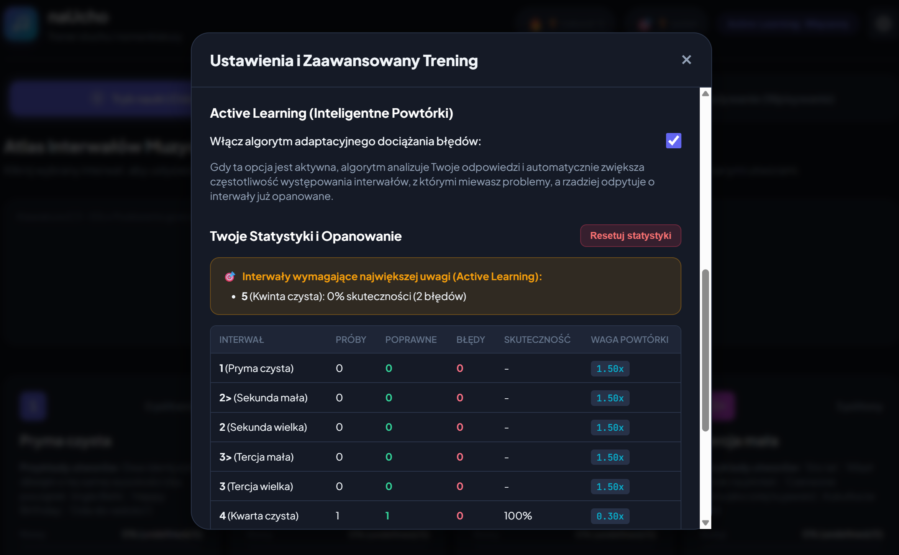

# 🎵 naUcho

[](https://fistaszek017.github.io/naUcho/)

Interaktywna aplikacja webowa do treningu słuchu muzycznego i rozpoznawania interwałów. Powstała z myślą o osobach uczących się muzyki – działa bezpośrednio w przeglądarce, generuje dźwięki w czasie rzeczywistym i dopasowuje poziom trudności do postępów użytkownika.

👉 **Przetestuj na żywo:** [fistaszek017.github.io/naUcho](https://fistaszek017.github.io/naUcho/)

---



|        Klawiatura i tryb nauki         |             Statystyki i postępy              |
| :------------------------------------: | :-------------------------------------------: |
|  |  |

---

## ✨ Co potrafi aplikacja?

- **Synteza dźwięku na żywo** – wszystkie interwały i dźwięki klawiatury są generowane proceduralnie za pomocą natywnego **Web Audio API** (bez ładowania zewnętrznych plików `.mp3` czy `.wav`).
- **Adaptacyjna nauka (Active Learning)** – aplikacja śledzi, które interwały sprawiają najwięcej trudności, i częściej podsuwa je podczas kolejnych rund.
- **Interaktywne pianino** – pozwala wizualizować słyszane interwały oraz swobodnie dogrywać dźwięki na klawiaturze w trakcie ćwiczeń.
- **Różne tryby gry i podpowiedzi** – ćwiczenie interwałów harmonicznych (współbrzmienie) oraz melodycznych (w górę i w dół), wsparte bazą skojarzeń ze znanymi melodiami.
- **Zapisywanie postępów** – historia odpowiedzi, serie poprawnych trafień (streaki) i statystyki skuteczności zapisują się automatycznie w `LocalStorage`.

---

## 🛠️ Technologie i struktura

Projekt napisany w czystym **JavaScript (ES6+)**, **HTML5** oraz **CSS3** bez zewnętrznych bibliotek i frameworków:

```text
naUcho/
├── index.html               # Struktura aplikacji
├── css/
│   └── style.css            # Style i responsywny
└── js/
    ├── app.js               # Logika interfejsu i przepływ gry
    ├── audio-engine.js      # Generator dźwięku oparty o Web Audio API
    ├── active-learning.js   # Algorytm doboru interwałów do powtórek
    ├── intervals-data.js    # Definicje interwałów i skojarzeń melodycznych
    ├── piano.js             # Obsługa wizualnej klawiatury pianina
    ├── storage.js           # Zapis i odczyt statystyk w LocalStorage
    └── bundle.js            # Zbudowany skrypt produkcyjny
```
